# JOSE_VALERIANO-PROYECTO-ETL-DELIVERY
En el presente proyecto de Python vamos a realizar un pipeline ETL completo : extraer los datos, realizar una limpieza profunda, optimizar el tamaño, cargarlos en un motor SQL local (SQLite) y finalmente responder a las preguntas claves (insight) utilizando consultas SQL y gráficos.
## Parte 1 - Extracción y Diagnóstico (Extract) 🗄️
Vamos a utilizar 2 carpetas con archivos .csv para trabajar la data: 
- restaurants.csv: Contiene dirección completa concatenada, puntajes y rango de precios en símbolos ($).

- restaurant-menus.csv: Contiene el nombre del plato y su precio en texto.

Para ello cargaremos ambas carpetas en dataframes con panda:

``` python
import pandas as pd
df_restaurantes = pd.read_csv("/Workspace/Users/***/JOSE_VALERIANO-PROYECTO-ETL-DELIVERY/PROYECTO_FINAL (1)/restaurants.csv/restaurants.csv")
```

``` python
import pandas as pd
import glob

archivos = glob.glob( "/Workspace/Users/***/JOSE_VALERIANO-PROYECTO-ETL-DELIVERY/PROYECTO_FINAL (1)/restaurant-menus.csv/*.csv")

df_menus = pd.concat([pd.read_csv(f) for f in archivos],
            ignore_index=True
)
```
Con los datos ya cargados, realizaremos un análisis exploratorio (Data Profiling):

``` python
print("Restaurantes:")
print(df_restaurantes.shape)

print("Menus:")
print(df_menus.shape)
```
- *resultado*

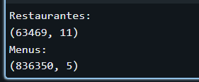

``` python
print(df_restaurantes.dtypes)

print(df_menus.dtypes)
```
- *resultado*

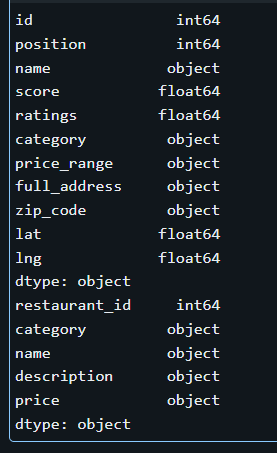

``` python
print(df_restaurantes.isnull().sum())
```
- *resultado*

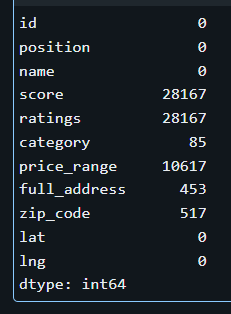

``` python
print(df_menus.isnull().sum())
```
- *resultado*

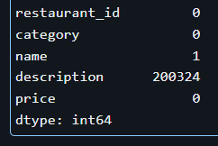

## Parte 2 - Ingeniería de Características y Limpieza (Transform) 🧹
Para este apartado, realizaremos limpieza y cambios en nuestros dataframes trabajados previamente.

En df_restaurantes:
1. Transformaremos la columna rango_de_precios, que contiene símbolos ($, $$, etc), con un diccionario para que la lectura de resultados sea mas entendible:
``` python
df_restaurantes["price_range"] = df_restaurantes["price_range"].replace({
    "$": "Económico",
    "$$": "Moderadamente caro",
    "$$$": "Caro",
    "$$$$": "Muy caro"
})
```
Por lo que luego del cambio se veria asi:
``` python
df_restaurantes["price_range"].value_counts(dropna=False)
```
- *resultado* 

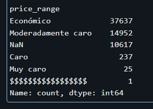

2. En la columna dirección_completa, que contiene informacion de la calle, ciudad, estado y código postal separados por comas, realizaremos un split para crear tres nuevas columnas independientes: calle, ciudad y estado_zip.
``` python
df_restaurantes[["calle", "ciudad", "estado_zip"]] = (
    df_restaurantes["full_address"]
    .str.split(",", expand=True, n=2)
)
```
Por lo que luego del cambio se veria asi:
``` python
df_restaurantes[
    ["full_address", "calle", "ciudad", "estado_zip"]
].head(10)
```
- *resultado*

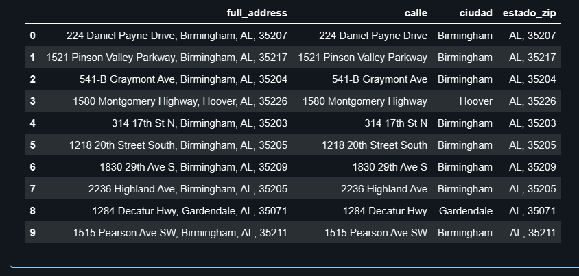

3. Eliminaremos los restaurantes que no tengan puntaje (score nulo) o cuyo puntaje sea 0 y el estandar de la columna category será a minúsculas.
``` python
df_restaurantes = df_restaurantes[
    (df_restaurantes["score"].notna()) &
    (df_restaurantes["score"] != 0)
]
```
``` python
df_restaurantes["category"] = df_restaurantes["category"].str.lower()
```
Por lo que luego del cambio se veria asi:
``` python
df_restaurantes["category"].head()
```
- *resultado*

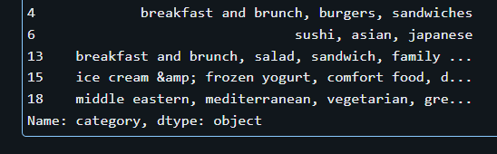

En df_menus:
1. La columna price viene como texto (ej. "15,99 USD"). Por lo que usaremos una funcion para eliminar el texto " USD", reemplazar la coma por un punto, y castear el resultado a formato decimal (float).
``` python
df_menus["price"] = (
    df_menus["price"]
    .str.replace(" USD", "", regex=False)
    .str.replace(",", ".", regex=False)
    .astype(float)
)
```
Por lo que luego del cambio se veria asi:
``` python
df_menus["price"].head(10)
```
- *resultado*

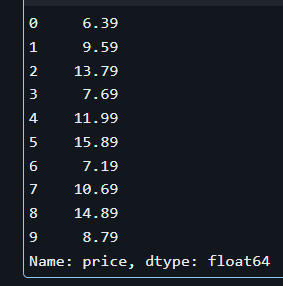

2. Eliminaremos los ítems del menú con precio igual a 0.0 o nulos.
``` python
df_menus = df_menus[
    (df_menus["price"].notna()) &
    (df_menus["price"] != 0.0)
]
```
### Optimización y Cruce (Control de Memoria RAM) ⚙️
* Para no colapsar la memoria del servidor, filtraremos en df_restaurantes, para quedarnos únicamente con aquellos que tengan más de 100 calificaciones (ratings).
``` python
df_restaurantes = df_restaurantes[
    (df_restaurantes["ratings"].notna()) &
    (df_restaurantes["ratings"] > 100)
]
```
* Realizamos un INNER JOIN entre el df_restaurantes filtrado y df_menus
utilizando el ID del restaurante y guardamos este cruce en un DataFrame llamado df_master.
``` python
df_master = pd.merge(
    df_restaurantes,
    df_menus,
    left_on="id",
    right_on="restaurant_id",
    how="inner"
)
```
- *resultado*

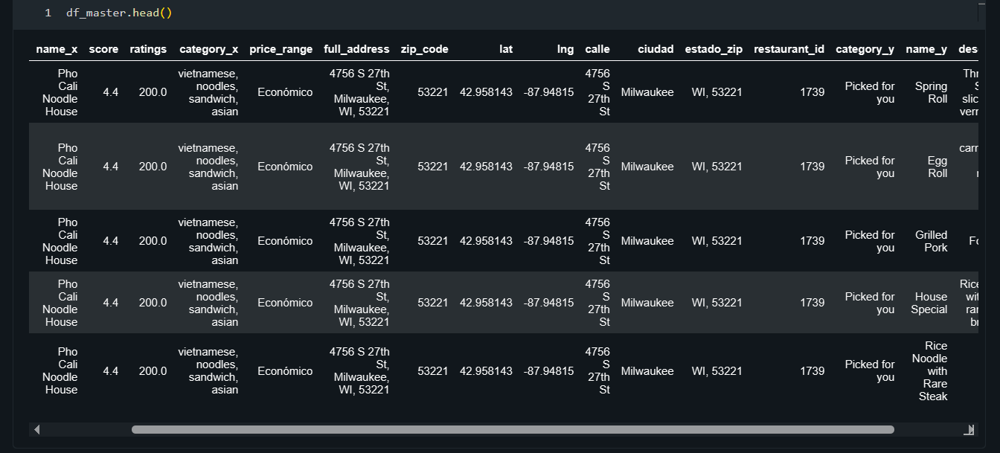

## Parte 3 - Carga a Base de Datos (Load) ✅
Importamos la librería sqlalchemy y generamos un motor (create_engine) para una base de datos SQLite local llamada delivery_insights.db.
``` python
from sqlalchemy import create_engine
engine = create_engine("sqlite:///delivery_insights.db")
```
``` python
df_master.to_sql(
    name="master_food_data",
    con=engine,
    if_exists="replace",
    index=False
)
```
- *resultado*

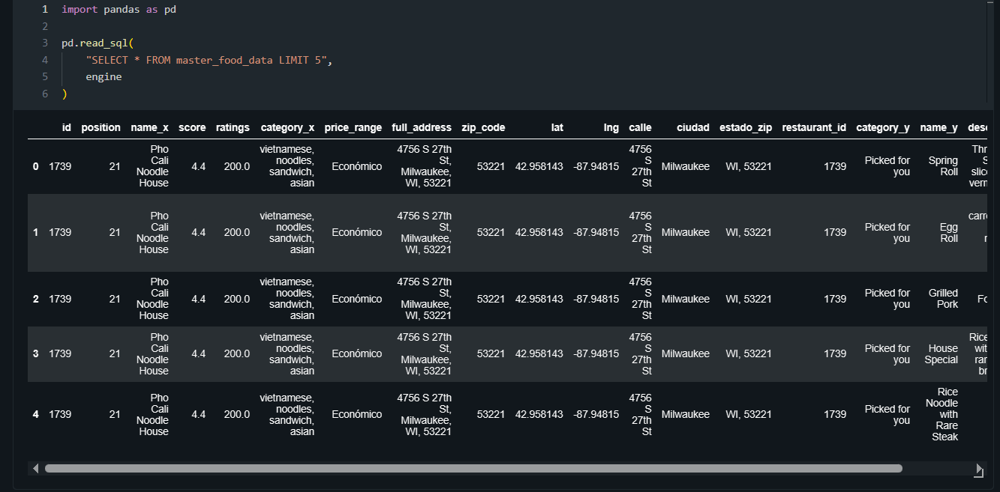

## Parte 4 - Business Intelligence 📊
En este apartado nos conectamos a la base de datos SQLite y responderemos a 4 preguntas de negocio:
1. Penetración Geográfica: ¿Cuáles son las 5 ciudades con la mayor cantidad de restaurantes consolidados?
``` python
from sqlalchemy import text
import pandas as pd
import matplotlib.pyplot as plt

query = """
SELECT
    ciudad,
    COUNT(DISTINCT id) AS cantidad_restaurantes
FROM master_food_data
GROUP BY ciudad
ORDER BY cantidad_restaurantes DESC
LIMIT 5
"""

df_top_ciudades = pd.read_sql(
    text(query),
    engine
)

print(df_top_ciudades)

plt.figure(figsize=(8,5))

plt.barh(
    df_top_ciudades["ciudad"],
    df_top_ciudades["cantidad_restaurantes"]
)

plt.title("Top 5 ciudades con más restaurantes consolidados")
plt.xlabel("Cantidad de restaurantes")
plt.ylabel("Ciudad")

plt.gca().invert_yaxis()

plt.show()
```
- *resultado* 

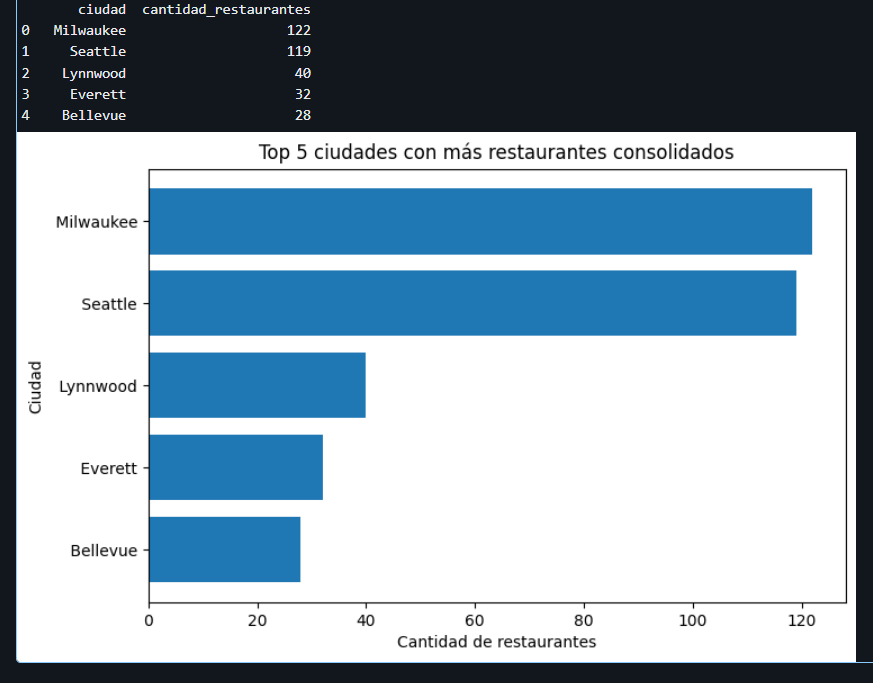

*Comentarios* : Las ciudades de Milwaukee y Seatle son las que mayor concentracion de restaurantes tiene presencia de entre los 5 primeros.

2. Análisis de Oportunidad de Precio: ¿Cual es la distrubucion de los restaurantes en el mercado a nivel general?
``` python
import pandas as pd
import matplotlib.pyplot as plt
from sqlalchemy import text

query = """
SELECT
    price_range AS rango_precio,
    COUNT(DISTINCT id) AS cantidad_restaurantes
FROM master_food_data
WHERE price_range IS NOT NULL
GROUP BY price_range
ORDER BY cantidad_restaurantes DESC
"""

df_rango_precio = pd.read_sql(
    text(query),
    engine
)

print(df_rango_precio)

fig, ax = plt.subplots(figsize=(8, 8))

ax.pie(
    df_rango_precio["cantidad_restaurantes"],
    labels=df_rango_precio["rango_precio"],
    autopct="%1.1f%%",
    startangle=90
)

centro = plt.Circle((0, 0), 0.70, fc="white")
fig.gca().add_artist(centro)

plt.title("Distribución de Restaurantes por Rango de Precio")

plt.tight_layout()
plt.show()
```
- *resultado*

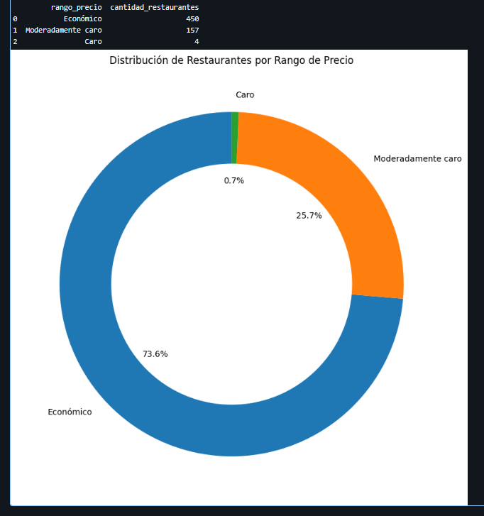

*Comentarios* : En su gran mayoria, los restaurantes de rango de precio economico son las que tienen mayor presencia en el mercado (73.60 %). El foco de negocio se mueve gracias a este tipo de restaurantes.

3. Estrategia de Menú por Ciudad: Para las 3 ciudades más populares obtenidas en la pregunta 1 ¿En qué ciudad es más caro comer en promedio? 
``` python
import pandas as pd
import matplotlib.pyplot as plt
from sqlalchemy import text

query = """
SELECT
    ciudad,
    ROUND(AVG(price), 2) AS precio_promedio
FROM master_food_data
WHERE ciudad IN (
    SELECT ciudad
    FROM master_food_data
    GROUP BY ciudad
    ORDER BY COUNT(DISTINCT id) DESC
    LIMIT 3
)
GROUP BY ciudad
ORDER BY precio_promedio DESC
"""

df_precio_ciudad = pd.read_sql(
    text(query),
    engine
)

print(df_precio_ciudad)

plt.figure(figsize=(8, 5))

bars = plt.bar(
    df_precio_ciudad["ciudad"],
    df_precio_ciudad["precio_promedio"]
)

plt.title("Precio Promedio de los Platos en las 3 Ciudades Más Populares")
plt.xlabel("Ciudad")
plt.ylabel("Precio Promedio (USD)")

for bar in bars:
    plt.text(
        bar.get_x() + bar.get_width()/2,
        bar.get_height(),
        f"{bar.get_height():.2f}",
        ha="center",
        va="bottom"
    )

plt.show()
```
- *resultado*

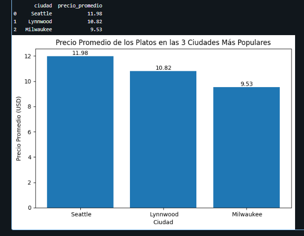

*Comentarios* : Se puede apreciar que claramente los restaurantes en la cuidad de Milwaukee tiene menor precio promedio, entre las 3 ciudades mas populares. Guarda sentido tambien que esta ciudad tambien se refleje en el top 1 de las mas consolidadas en general.

4. La Pregunta del Millón (Correlación Precio-Calidad): ¿Un restaurante más caro garantiza una mejor experiencia para el usuario?
``` python
import pandas as pd
import matplotlib.pyplot as plt
from sqlalchemy import text

query = """
SELECT
    price_range AS rango_precio,
    COUNT(DISTINCT id) AS cantidad_restaurantes
FROM master_food_data
WHERE price_range IS NOT NULL
GROUP BY price_range
ORDER BY cantidad_restaurantes DESC
"""

df_rango_precio = pd.read_sql(
    text(query),
    engine
)

print(df_rango_precio)

fig, ax = plt.subplots(figsize=(8, 8))

ax.pie(
    df_rango_precio["cantidad_restaurantes"],
    labels=df_rango_precio["rango_precio"],
    autopct="%1.1f%%",
    startangle=90
)

centro = plt.Circle((0, 0), 0.70, fc="white")
fig.gca().add_artist(centro)

plt.title("Distribución de Restaurantes por Rango de Precio")

plt.tight_layout()
plt.show()
```
- *resultado*

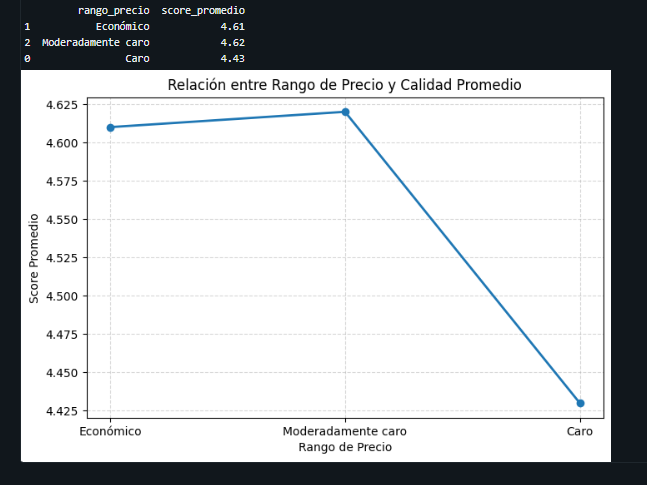

*Comentarios* : Que el precio sea mas caro, no necesariamente significa que el usuario califique como una mejor experiencia. Claramente se ve que los precios economicos y moderadamente caro son los que representan una mejor calificacion del usuario, siendo el precio moderadamente caro la que guarda mejor correlacion entre la calificacion de los comensales.


